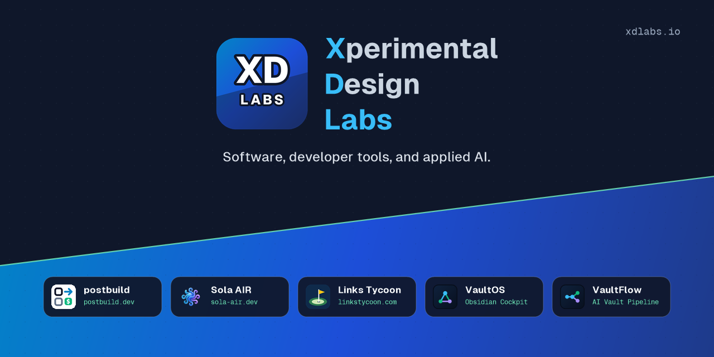

  

## Products & Open Source

- **[postbuild](https://www.postbuild.dev)** (
px git-paid) — Autonomous post-deploy launch engine: 12-point technical SEO, OpenGraph, security header & llms.txt scanner, auto-fix patches, and 85+ directory dispatch.
- **[Sola AIR](https://sola-air.dev)** (@sola-air-ui) — 7.8 KB reactive UI compiler and single-file .sola component framework with zero virtual DOM, fine-grained signals, and 37 accessible UI components.
- **[Links Tycoon](https://linkstycoon.com)** — Isometric browser-based golf course architecture, turf agronomy, and club management simulation game.
- **[VaultOS](https://github.com/Rbm3267/obsidian-vaultos)** — Sovereign Bento command center dashboard and multi-model AI assistant for Obsidian vaults.
- **[VaultFlow](https://www.xdlabs.io/work/vaultflow/)** — AI vault pipeline turning voice memos, transcripts, and rough notes into structured summaries and action items.